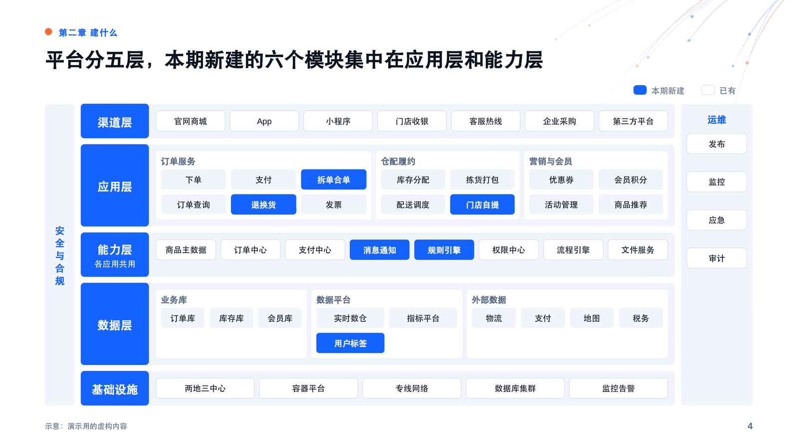
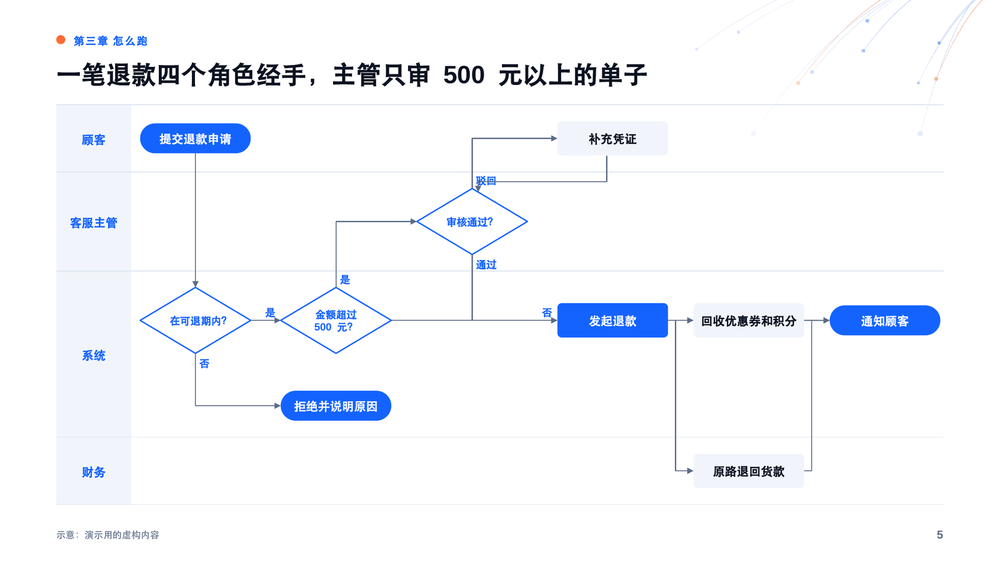
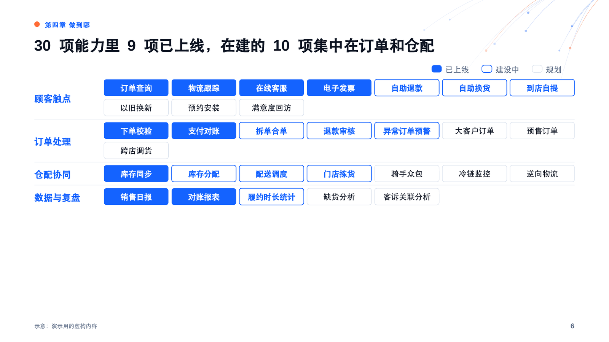
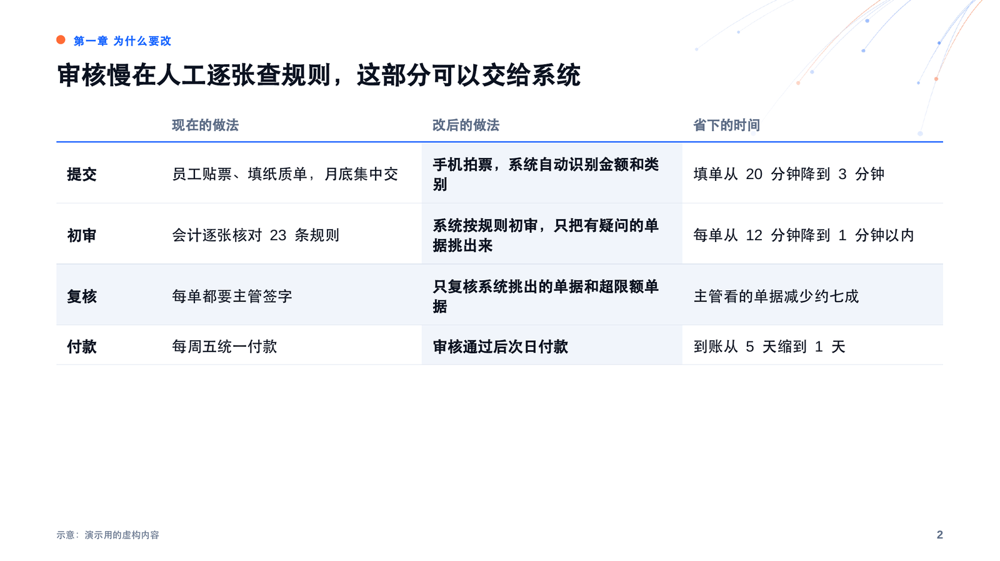
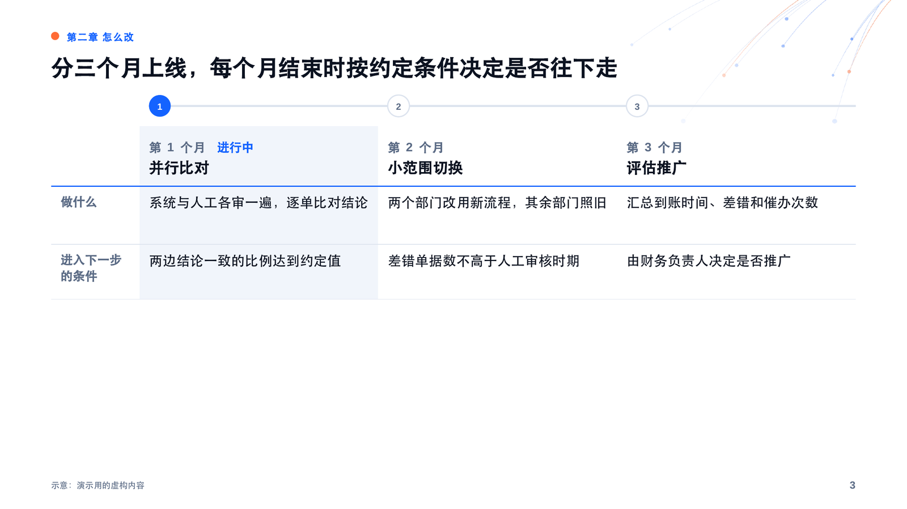

<p align="center">
  
</p>

# one-prompt-ppt

[中文](README.md) | English

Give your AI agent the material plus one sentence about who the audience is, and it hands back a structured, fully editable `.pptx`.

This is an agent skill for tools that support skills, such as Claude Code. It trains no model and calls no online service: the rules are Markdown files, and checking and drawing are done by three Python scripts.

> The rule files are written in Chinese, and the skill has only been tested with Chinese material. The screenshots below show Chinese slides.

## What it solves

When an AI is asked to make slides directly, the usual result is a deck where every page has text and every page looks equally important, and the reader cannot tell what the conclusion is. The model starts listing pages as soon as it gets the material, so pages only have an order; none of them summarizes the others.

one-prompt-ppt makes the model work in a fixed order. A layer is not started until the one above it is settled:

| Layer | What is decided |
|---|---|
| 0 Audience | Who is listening, what they care about, which terms need plain wording |
| 1 Deck | One-sentence message, the sections, one claim per section |
| 2 Section | How the section unfolds |
| 3 Slide | The title states a conclusion; one slide says one thing |
| 4 Block | How the items on the slide relate to each other, which decides the diagram |

Each layer is checked by a script after it is written: does every section have a claim, does every slide have evidence, can the numbers in a title be found in the material. The argument tree (message, sections, slide titles) needs your confirmation before the work continues.

## Results

The slides below were all produced by the drawing library that ships with the skill, from fictional test material. Every box and every line is a native PowerPoint shape and can be edited after opening.

**Layered architecture diagram**: groups inside a layer, cross-cutting concerns drawn at the sides, and the modules in scope highlighted according to the legend.



**Swimlane flowchart**: decisions, branches, returns, parallel sign-off. You only state what each step is called and where it goes next; placement and routing are computed by the library.



**Capability map**: dozens of small cells laid out by group and graded by status.



**Object-by-aspect table and phased plan**: an ordinary content slide is planned as "a few objects, two or three aspects for each". Column heads and row names are written once.

<table>
  <tr>
    <td></td>
    <td></td>
  </tr>
</table>

## Install

Requires Python 3.9 or later and `python-pptx`.

```bash
# Claude Code: put it in your personal skills directory
git clone https://github.com/li2092/one-prompt-ppt.git ~/.claude/skills/one-prompt-ppt

pip install -r ~/.claude/skills/one-prompt-ppt/requirements.txt
```

For other tools that support skills, put the whole directory into the tool's skills directory. The entry file is `SKILL.md`.

If you want the model to turn the finished deck into images and check it page by page, also install LibreOffice and `pdftoppm` (on macOS: `brew install --cask libreoffice` and `brew install poppler`). The deck is still produced without them; the model just cannot see what it looks like.

## Usage

Give it the material and one sentence about the audience:

```text
Use one-prompt-ppt to make a decision-request deck. The material is in ./expense-review-proposal.md.
The audience is the vice president in charge of finance. They do not know the system
and care most about the review cycle and the risk of errors.
```

It then does the following in order:

1. Asks you about the audience, the occasion or the purpose if any of them is unclear.
2. Writes the message and the titles of every section and slide, and waits for your confirmation.
3. Plans the content of each slide against the material, runs the checks, and has a reviewer with no prior context read it through.
4. Picks a template, generates the `.pptx`, and inspects the result as images.
5. On delivery, reports what was changed, which hints were left as they are, and which items were written as "to be decided" because the material does not contain them.

If you only want the outline, or want an old deck restructured, just say so.

## Diagrams

Ready-made drawings in `scripts/pptkit.py`:

| Relation between the items | Diagram |
|---|---|
| Sequence | Step flow, phased flow, flowchart, swimlane flowchart |
| Branching | Flowchart (decision nodes with branch lines) |
| Hierarchy | Layers, layered architecture diagram, capability map |
| Comparison, cross-reference | Comparison table, side-by-side columns |
| Cause and effect | Causal chain |
| Parallel items | Card group, short item list |
| Emphasis | Big numbers, highlighted figures |

All diagrams on one slide share a single font scale, chosen from the height left on the slide: enlarged when there is little content, reduced when there is a lot. If the content still does not fit at the smallest scale, the library reports it and suggests splitting the slide. Loops, trees, 2x2 matrices and native charts have no ready-made drawing; the model draws them with the basic functions.

## Templates

Three templates are included: 航线 (Routes), 极光 (Aurora) and 朱砂 (Cinnabar). Each has five layouts: cover, agenda, section opener, content and closing. The templates and their background art are generated by `assets/templates/build.py` and can be modified and rebuilt.


You can also use your own template. Give it the `.pptx`; it reads the layouts, placeholders, colors and fonts, writes a style file, and generates the deck from that. Fixed elements such as the logo and footer are kept as they are. See section 3 of `references/render.md`.

## Layout

```text
SKILL.md                 Entry: the workflow and which file to read at each step
references/              Rules for the five layers, four occasions, slide planning, diagrams, wording, review
scripts/storyline.py     Outline checks: check, view, approve
scripts/pptkit.py        Drawing library: builds slides and diagrams on a template
scripts/template_info.py Reads a template supplied by the user
scripts/preview.py       Converts the finished deck into per-slide images
assets/templates/        The three templates and the script that builds them
assets/example-outline.json  Example outline
```

## Known limitations

- Decks have only been inspected page by page in LibreOffice. Rendering in PowerPoint and WPS, especially whether flowchart connectors stay attached, has not been verified systematically.
- The templates specify the font Microsoft YaHei. On a machine without it, text widths will differ.
- The models tested are Claude Sonnet and DeepSeek. Smaller models have not been tried.
- The rule files are in Chinese and only Chinese material has been tested.
- A flowchart should stay within 16 nodes. Beyond that, split it over two slides with an overview on the first.
- The scripts only check the shape of the structure. Whether the content holds up still requires you to read the titles.

## License

MIT, see `LICENSE`.
