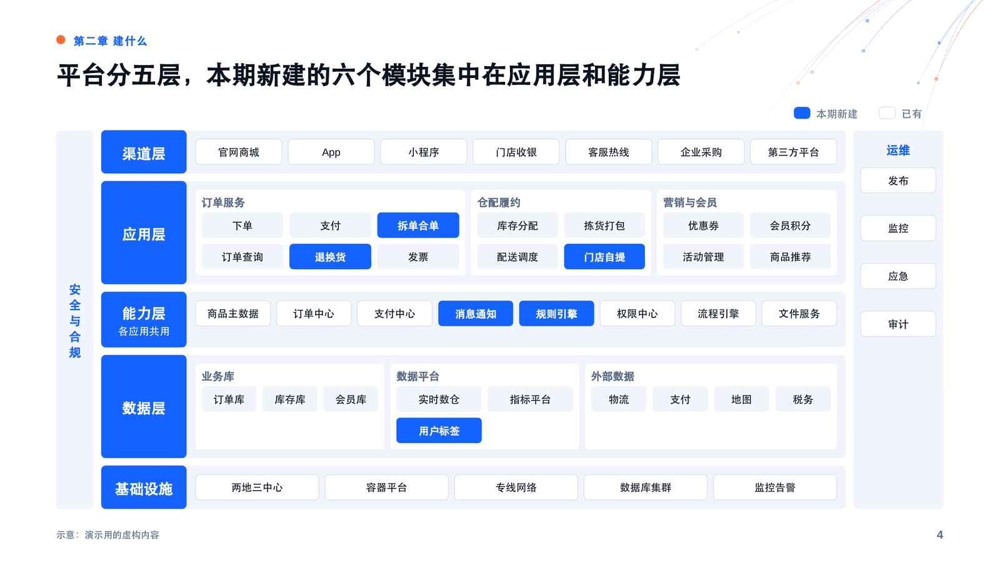
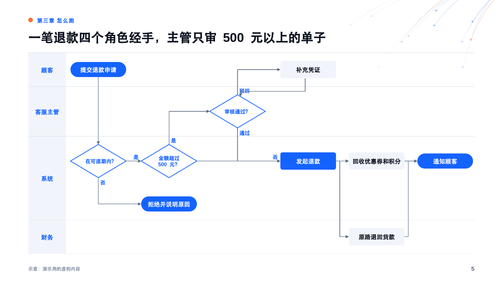
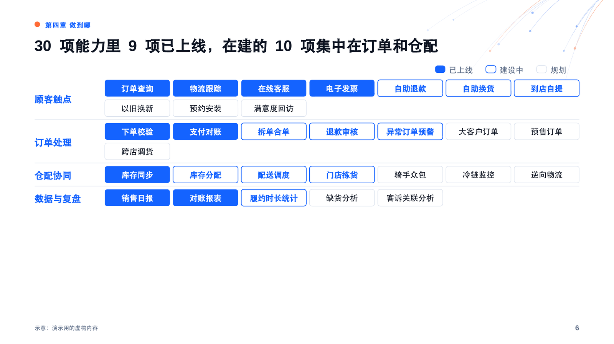
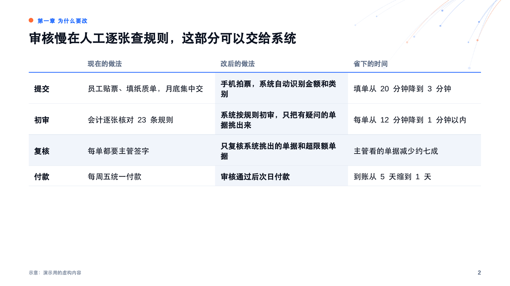
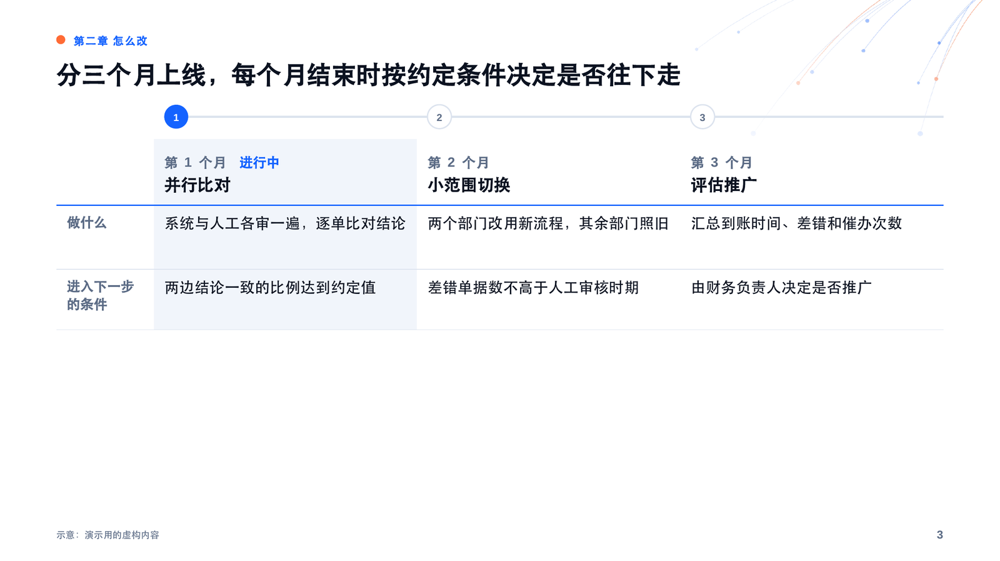

<p align="center">
  
</p>

# one-prompt-ppt

中文 | [English](README.en.md)

给 AI 一份材料，再说一句讲给谁听，它交回一份有主次、可编辑的 `.pptx`。

这是一个 agent skill，装进 Claude Code 这类支持 skill 的工具里使用。它不训练模型，也不调用任何在线服务：规则写在 Markdown 里，检查和绘图用三个 Python 脚本完成。

> An agent skill that turns your material plus one sentence about the audience into a structured, fully editable `.pptx`, with architecture diagrams, swimlane flowcharts and capability maps drawn as native shapes.

## 它解决什么

让 AI 直接做 PPT，常见的结果是每页都有字、每页都差不多重要，读完不知道结论是什么。原因是模型拿到材料就开始列页面，页面之间只有先后，没有谁概括谁。

one-prompt-ppt 让模型按固定的顺序做，上一层没定好不做下一层：

| 层 | 定什么 |
|---|---|
| 0 听众 | 讲给谁听，他关心什么，哪些词要换成白话 |
| 1 整份 | 一句话主旨，分几章，每章一句论点 |
| 2 章 | 这一章怎么展开 |
| 3 页 | 标题写结论，一页只说一件事 |
| 4 块 | 这几项内容是什么关系，按关系选图示 |

每一层写完用脚本核对：章有没有论点，页有没有证据，标题里的数字在材料里有没有出处。论证树（主旨、章、页的标题）要你确认后才往下做。

## 效果

下面的页面都由 skill 自带的绘图库生成，内容是测试用的虚构材料。每个框、每条线都是 PowerPoint 的原生形状，打开就能改。

**分层架构图**：层内可以再分组，贯穿各层的内容画在两侧，本期要讲的模块按图例加重。



**泳道流程图**：判断、分支、退回、并行会签。只要写清每一步叫什么、下一步去哪，排列和走线由绘图库计算。



**能力地图**：几十个小格子按组排开，按状态分档。



**对象乘方面的表、分阶段计划**：普通内容页按“几个对象，每个对象说两三个方面”来规划，表头和行名各写一次。

<table>
  <tr>
    <td></td>
    <td></td>
  </tr>
</table>

## 安装

需要 Python 3.9 以上和 `python-pptx`。

```bash
# Claude Code：放进个人 skill 目录
git clone https://github.com/li2092/one-prompt-ppt.git ~/.claude/skills/one-prompt-ppt

pip install -r ~/.claude/skills/one-prompt-ppt/requirements.txt
```

其他支持 skill 的工具，把整个目录放进它的 skill 目录即可，入口文件是 `SKILL.md`。

想让模型自己把成品转成图片逐页检查，还要装 LibreOffice 和 `pdftoppm`（macOS 上是 `brew install --cask libreoffice` 和 `brew install poppler`）。不装也能出 PPT，只是模型看不到成品的样子。

## 怎么用

把材料给它，再说一句讲给谁听：

```text
用 one-prompt-ppt 做一份决策请示的 PPT。材料在 ./报销审核改进方案.md。
听众是分管财务的副总，不懂系统，最关心审核周期和出错的风险。
```

它会依次做这几件事：

1. 听众、场合、目的有说不清的地方，先问你。
2. 写出主旨和各章、各页的标题，等你确认。
3. 对着材料逐页规划内容，跑检查，再找一个不带上下文的评审读一遍。
4. 选一套模板，生成 `.pptx`，把成品转成图片自查。
5. 交付时说明：改了什么、哪些提示保留了、哪些内容因为材料里没有而写成了“待定”。

只想要大纲不要成品，或者拿一份旧 PPT 让它重排结构，直接说就行。

## 图示

`scripts/pptkit.py` 里现成的画法：

| 内容之间的关系 | 图示 |
|---|---|
| 顺序 | 步骤流程、分阶段流程、流程图、泳道流程图 |
| 分支 | 流程图（判断节点加分支线） |
| 层级 | 分层、分层架构图、能力地图 |
| 对比、交叉 | 对照表、对照栏 |
| 因果 | 因果链 |
| 并列 | 卡片组、短条目清单 |
| 强调 | 大数字、强调数字 |

一页上的图示共用一档字号，按页面剩余的高度自动选：内容少就放大，内容多就缩小；缩到最小仍放不下时会提醒拆页。闭环、树、四象限、原生图表这几种没有现成画法，模型会用基础函数自己画。

## 模板

自带三套模板：航线、极光、朱砂。每套有封面、目录、章首页、正文、结尾五种版式。模板和底图都由 `assets/templates/build.py` 生成，可以改了重跑。


也可以用自己的模板。把 `.pptx` 给它，它会先读出版式、占位符、颜色和字体，写一个风格文件，再照着生成，标志、页脚这些固定元素原样保留。做法见 `references/render.md` 第三节。

## 目录

```text
SKILL.md                 入口：流程和各步要读的文件
references/              五层的规则、四类场合、页面规划、图示、措辞、评审
scripts/storyline.py     大纲检查：check、view、approve
scripts/pptkit.py        绘图库：在模板上生成页面和图示
scripts/template_info.py 读用户给的模板
scripts/preview.py       把成品转成逐页图片
assets/templates/        三套模板和生成它们的脚本
assets/example-outline.json  大纲范例
```

## 已知限制

- 成品只在 LibreOffice 里逐页看过。PowerPoint 和 WPS 里的显示，尤其是流程图连线的吸附，还没有系统验证过。
- 模板里写的字体是微软雅黑。电脑上没有这个字体时，字宽会有出入。
- 实测过的模型是 Claude Sonnet 和 DeepSeek。更小的模型没有试过。
- 流程图建议 16 个节点以内。再多就拆成两页，第一页放总图。
- 机器检查只看结构的形状。内容是否成立，要靠你读一遍标题。

## 许可

MIT，见 `LICENSE`。
